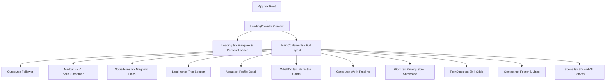

# THE PORTFOLIO ENGINE
## An Absolute Beginner's Blueprint & Reference Manual
### A Complete Guide to Code Architecture, Layout Reactivity, and Web Animation

| Property | Value |
| :--- | :--- |
| **Target Audience** | Web Designers, Developers, and Beginners |
| **Subject Project** | Manohar Kendhuli - Interactive Portfolio Website |
| **Framework System** | React 18 / TypeScript / Vite |
| **Primary Animation Tool** | GSAP (GreenSock Animation Platform) + Three.js |
| **Document Version** | 2.0.0 (Production Release) |

---

## 1. High-Level Blueprint & Structure

To understand this project, imagine you are building a physical gallery house. The layout must guide visitors step-by-step through a loading hallway, into the main lobby, and past several exhibit boards. In software, this is achieved by orchestrating several files together.

Below is the nesting layout of the application:



### A. The Entry Pipeline Sequence
When a user opens the webpage, the following steps occur:
1. **Mounting the App**: The browser loads `index.html`, boots the runtime scripts in [main.tsx](file:///c:/Users/hp/OneDrive/Desktop/Projects/Portfolio-Website/src/main.tsx), and renders the [App.tsx](file:///c:/Users/hp/OneDrive/Desktop/Projects/Portfolio-Website/src/App.tsx) component.
2. **Locking Scroll & Preloading**: The [LoadingProvider.tsx](file:///c:/Users/hp/OneDrive/Desktop/Projects/Portfolio-Website/src/context/LoadingProvider.tsx) context initializes and renders [Loading.tsx](file:///c:/Users/hp/OneDrive/Desktop/Projects/Portfolio-Website/src/components/Loading.tsx). This component locks the body overflow (`overflow-y: hidden`) to block scrolling. Simultaneously, a loading percentage count-up ticks from 0% to 100%.
3. **Entrance Transition**: As soon as the count reaches 100%, the loader executes [initialFX.ts](file:///c:/Users/hp/OneDrive/Desktop/Projects/Portfolio-Website/src/components/utils/initialFX.ts). This unlocks body scrolling, splits the heading texts into individual letters using GSAP's `SplitText` plugin, and slides them up to reveal the main screen.

### B. The Main Page Single-Page Layout
Once the loader finishes, the screen renders [MainContainer.tsx](file:///c:/Users/hp/OneDrive/Desktop/Projects/Portfolio-Website/src/components/MainContainer.tsx). The sections are arranged vertically. To enhance the scrolling feel on desktop browsers, **GSAP ScrollSmoother** is initialized inside [Navbar.tsx](file:///c:/Users/hp/OneDrive/Desktop/Projects/Portfolio-Website/src/components/Navbar.tsx). This creates momentum-based inertia scrolling. On mobile, this is bypassed for standard mobile touch scrolls.

---

## 2. Page-by-Page & File-by-File Technical Guide

This section breaks down every primary code file in the project, detailing exactly what it is responsible for, how it coordinates with the rest of the application, and the full source code for reference.

### 1. App.tsx
* **Path**: [App.tsx](file:///c:/Users/hp/OneDrive/Desktop/Projects/Portfolio-Website/src/App.tsx)
* **Role**: The entry controller root.
* **How it Works**: It wraps the application in the `LoadingProvider` context and lazy-loads the `MainContainer` component, ensuring the loading screen handles rendering states smoothly.
* **Full Code**:
```typescript
import { lazy, Suspense } from "react";
import "./App.css";

const MainContainer = lazy(() => import("./components/MainContainer"));
import { LoadingProvider } from "./context/LoadingProvider";

const App = () => {
  return (
    <>
      <LoadingProvider>
        <Suspense>
          <MainContainer />
        </Suspense>
      </LoadingProvider>
    </>
  );
};

export default App;
```

---

### 2. main.tsx
* **Path**: [main.tsx](file:///c:/Users/hp/OneDrive/Desktop/Projects/Portfolio-Website/src/main.tsx)
* **Role**: React mounting bridge.
* **How it Works**: Connects React's virtual root component (`App`) to the real DOM entry node (`#root`) in `index.html` under strict mode.
* **Full Code**:
```typescript
import { StrictMode } from "react";
import { createRoot } from "react-dom/client";
import App from "./App.tsx";
import "./index.css";

createRoot(document.getElementById("root")!).render(
  <StrictMode>
    <App />
  </StrictMode>
);
```

---

### 3. MainContainer.tsx
* **Path**: [MainContainer.tsx](file:///c:/Users/hp/OneDrive/Desktop/Projects/Portfolio-Website/src/components/MainContainer.tsx)
* **Role**: Page layout manager and responsive viewport tracker.
* **How it Works**: It listens to the window resize event to determine whether the screen is desktop-sized (`width > 1024px`). It sets up the smooth scrolling wrappers (`#smooth-wrapper` and `#smooth-content`) and mounts the components.
* **Full Code**:
```typescript
import { lazy, PropsWithChildren, Suspense, useEffect, useState } from "react";
import About from "./About";
import Career from "./Career";
import Contact from "./Contact";
import Cursor from "./Cursor";
import Landing from "./Landing";
import Navbar from "./Navbar";
import SocialIcons from "./SocialIcons";
import WhatIDo from "./WhatIDo";
import Work from "./Work";
import setSplitText from "./utils/splitText";

const TechStack = lazy(() => import("./TechStack"));

const MainContainer = ({ children }: PropsWithChildren) => {
  const [isDesktopView, setIsDesktopView] = useState<boolean>(
    window.innerWidth > 1024
  );

  useEffect(() => {
    const resizeHandler = () => {
      setSplitText();
      setIsDesktopView(window.innerWidth > 1024);
    };
    resizeHandler();
    window.addEventListener("resize", resizeHandler);
    return () => {
      window.removeEventListener("resize", resizeHandler);
    };
  }, [isDesktopView]);

  return (
    <div className="container-main">
      <Cursor />
      <Navbar />
      <SocialIcons />
      {isDesktopView && children}
      <div id="smooth-wrapper">
        <div id="smooth-content">
          <div className="container-main">
            <Landing>{!isDesktopView && children}</Landing>
            <About />
            <WhatIDo />
            <Career />
            <Work />
            <Suspense fallback={<div>Loading....</div>}>
              <TechStack />
            </Suspense>
            <Contact />
          </div>
        </div>
      </div>
    </div>
  );
};

export default MainContainer;
```

---

### 4. Navbar.tsx
* **Path**: [Navbar.tsx](file:///c:/Users/hp/OneDrive/Desktop/Projects/Portfolio-Website/src/components/Navbar.tsx)
* **Role**: Header menu and momentum scroll smooth engine initiator.
* **How it Works**: Registers the GSAP `ScrollSmoother` plugin. If the screen is a desktop screen, it overrides standard anchor scroll mechanics to smoothly glide the viewport using `smoother.scrollTo(section, true)`.
* **Full Code**:
```typescript
import { useEffect } from "react";
import { ScrollTrigger } from "gsap/ScrollTrigger";
import HoverLinks from "./HoverLinks";
import { gsap } from "gsap";
import { ScrollSmoother } from "gsap/ScrollSmoother";
import "./styles/Navbar.css";

gsap.registerPlugin(ScrollSmoother, ScrollTrigger);
export let smoother: ScrollSmoother;

const Navbar = () => {
  useEffect(() => {
    smoother = ScrollSmoother.create({
      wrapper: "#smooth-wrapper",
      content: "#smooth-content",
      smooth: 1.7,
      speed: 1.7,
      effects: true,
      autoResize: true,
      ignoreMobileResize: true,
    });

    if (smoother) {
      smoother.scrollTop(0);
      smoother.paused(true);
    }

    let links = document.querySelectorAll(".header ul a");
    links.forEach((elem) => {
      let element = elem as HTMLAnchorElement;
      element.addEventListener("click", (e) => {
        if (window.innerWidth > 1024 && smoother) {
          e.preventDefault();
          let elem = e.currentTarget as HTMLAnchorElement;
          let section = elem.getAttribute("data-href");
          smoother.scrollTo(section, true, "top top");
        }
      });
    });
    window.addEventListener("resize", () => {
      if (smoother) {
        ScrollSmoother.refresh(true);
      }
    });
  }, []);
  return (
    <>
      <div className="header">
        <a href="/#" className="navbar-title" data-cursor="disable">
          MANOHAR
        </a>
        <a
          href="mailto:manoharmk2020@gmail.com"
          className="navbar-connect"
          data-cursor="disable"
        >
          manoharmk2020@gmail.com
        </a>
        <ul>
          <li>
            <a data-href="#about" href="#about">
              <HoverLinks text="ABOUT" />
            </a>
          </li>
          <li>
            <a data-href="#work" href="#work">
              <HoverLinks text="WORK" />
            </a>
          </li>
          <li>
            <a data-href="#contact" href="#contact">
              <HoverLinks text="CONTACT" />
            </a>
          </li>
        </ul>
      </div>

      <div className="landing-circle1"></div>
      <div className="landing-circle2"></div>
      <div className="nav-fade"></div>
    </>
  );
};

export default Navbar;
```

---

### 5. Loading.tsx
* **Path**: [Loading.tsx](file:///c:/Users/hp/OneDrive/Desktop/Projects/Portfolio-Website/src/components/Loading.tsx)
* **Role**: Animated marquee and preloader page element.
* **How it Works**: Increments progress percentage inside a randomized timing interval to mock assets parsing. When loading reaches 100%, it resolves the promise to trigger the opening FX and sets `setIsLoading(false)`.
* **Full Code**:
```typescript
import { useEffect, useState } from "react";
import "./styles/Loading.css";
import { useLoading } from "../context/LoadingProvider";

import Marquee from "react-fast-marquee";

const Loading = ({ percent }: { percent: number }) => {
  const { setIsLoading } = useLoading();
  const [loaded, setLoaded] = useState(false);
  const [isLoaded, setIsLoaded] = useState(false);
  const [clicked, setClicked] = useState(false);

  if (percent >= 100) {
    setTimeout(() => {
      setLoaded(true);
      setTimeout(() => {
        setIsLoaded(true);
      }, 1000);
    }, 600);
  }

  useEffect(() => {
    import("./utils/initialFX").then((module) => {
      if (isLoaded) {
        setClicked(true);
        setTimeout(() => {
          if (module.initialFX) {
            module.initialFX();
          }
          setIsLoading(false);
        }, 900);
      }
    });
  }, [isLoaded]);

  function handleMouseMove(e: React.MouseEvent<HTMLElement>) {
    const { currentTarget: target } = e;
    const rect = target.getBoundingClientRect();
    const x = e.clientX - rect.left;
    const y = e.clientY - rect.top;
    target.style.setProperty("--mouse-x", `${x}px`);
    target.style.setProperty("--mouse-y", `${y}px`);
  }

  return (
    <>
      <div className="loading-header">
        <a href="/#" className="loader-title" data-cursor="disable">
          <span className="logo-brackets">&lt;</span>
          <span className="logo-text">MANOHAR.DEV</span>
          <span className="logo-brackets">/&gt;</span>
          <span className="logo-cursor">_</span>
        </a>
        <div className={`loaderGame ${clicked && "loader-out"}`}>
          <div className="loaderGame-container">
            <div className="loaderGame-in">
              {[...Array(27)].map((_, index) => (
                <div className="loaderGame-line" key={index}></div>
              ))}
            </div>
            <div className="loaderGame-ball"></div>
          </div>
        </div>
      </div>
      <div className="loading-screen">
        <div className="loading-marquee">
          <Marquee>
            <span> A Creative Developer</span> <span>A Creative Designer</span>
            <span> A Creative Developer</span> <span>A Creative Designer</span>
          </Marquee>
        </div>
        <div
          className={`loading-wrap ${clicked && "loading-clicked"}`}
          onMouseMove={(e) => handleMouseMove(e)}
        >
          <div className="loading-hover"></div>
          <div className={`loading-button ${loaded && "loading-complete"}`}>
            <div className="loading-container">
              <div className="loading-content">
                <div className="loading-content-in">
                  Loading <span>{percent}%</span>
                </div>
              </div>
              <div className="loading-box"></div>
            </div>
            <div className="loading-content2">
              <span>Welcome</span>
            </div>
          </div>
        </div>
      </div>
    </>
  );
};

export default Loading;

export const setProgress = (setLoading: (value: number) => void) => {
  let percent: number = 0;

  let interval = setInterval(() => {
    if (percent < 100) {
      let rand = Math.round(Math.random() * 8) + 2;
      percent = Math.min(100, percent + rand);
      setLoading(percent);
    } else {
      clearInterval(interval);
    }
  }, 40);

  function clear() {
    clearInterval(interval);
    setLoading(100);
  }

  function loaded() {
    return new Promise<number>((resolve) => {
      clearInterval(interval);
      percent = 100;
      setLoading(100);
      resolve(100);
    });
  }
  return { loaded, percent, clear };
};
```

---

### 6. LoadingProvider.tsx
* **Path**: [LoadingProvider.tsx](file:///c:/Users/hp/OneDrive/Desktop/Projects/Portfolio-Website/src/context/LoadingProvider.tsx)
* **Role**: Core application state provider for initial assets loader.
* **How it Works**: Uses React Context to bundle loading percentages and visibility status. If loading is active, it blocks background interactions.
* **Full Code**:
```typescript
import {
  createContext,
  PropsWithChildren,
  useContext,
  useEffect,
  useState,
} from "react";
import Loading, { setProgress } from "../components/Loading";

interface LoadingType {
  isLoading: boolean;
  setIsLoading: (state: boolean) => void;
  setLoading: (percent: number) => void;
}

export const LoadingContext = createContext<LoadingType | null>(null);

export const LoadingProvider = ({ children }: PropsWithChildren) => {
  const [isLoading, setIsLoading] = useState(true);
  const [loading, setLoading] = useState(0);

  const value = {
    isLoading,
    setIsLoading,
    setLoading,
  };
  
  useEffect(() => {
    const progress = setProgress((value) => setLoading(value));
    return () => {
      progress.clear();
    };
  }, []);

  return (
    <LoadingContext.Provider value={value as LoadingType}>
      {isLoading && <Loading percent={loading} />}
      <main className="main-body">{children}</main>
    </LoadingContext.Provider>
  );
};

export const useLoading = () => {
  const context = useContext(LoadingContext);
  if (!context) {
    throw new Error("useLoading must be used within a LoadingProvider");
  }
  return context;
};
```

---

### 7. Cursor.tsx
* **Path**: [Cursor.tsx](file:///c:/Users/hp/OneDrive/Desktop/Projects/Portfolio-Website/src/components/Cursor.tsx)
* **Role**: Custom trailing circle cursor follower.
* **How it Works**: Implements **linear interpolation (lerp)** within a `requestAnimationFrame` loop. It eases the circle follower to the actual cursor coordinate with a delay factor, scaling or disabling the visibility dynamically using elements mapped with `data-cursor` properties.
* **Full Code**:
```typescript
import { useEffect, useRef } from "react";
import "./styles/Cursor.css";
import gsap from "gsap";

const Cursor = () => {
  const cursorRef = useRef<HTMLDivElement>(null);
  useEffect(() => {
    let hover = false;
    const cursor = cursorRef.current!;
    const mousePos = { x: 0, y: 0 };
    const cursorPos = { x: 0, y: 0 };
    document.addEventListener("mousemove", (e) => {
      mousePos.x = e.clientX;
      mousePos.y = e.clientY;
    });
    requestAnimationFrame(function loop() {
      if (!hover) {
        const delay = 6;
        cursorPos.x += (mousePos.x - cursorPos.x) / delay;
        cursorPos.y += (mousePos.y - cursorPos.y) / delay;
        gsap.to(cursor, { x: cursorPos.x, y: cursorPos.y, duration: 0.1 });
      }
      requestAnimationFrame(loop);
    });
    document.querySelectorAll("[data-cursor]").forEach((item) => {
      const element = item as HTMLElement;
      element.addEventListener("mouseover", (e: MouseEvent) => {
        const target = e.currentTarget as HTMLElement;
        const rect = target.getBoundingClientRect();

        if (element.dataset.cursor === "icons") {
          cursor.classList.add("cursor-icons");
          gsap.to(cursor, { x: rect.left, y: rect.top, duration: 0.1 });
          cursor.style.setProperty("--cursorH", `${rect.height}px`);
          hover = true;
        }
        if (element.dataset.cursor === "disable") {
          cursor.classList.add("cursor-disable");
        }
      });
      element.addEventListener("mouseout", () => {
        cursor.classList.remove("cursor-disable", "cursor-icons");
        hover = false;
      });
    });
  }, []);

  return <div className="cursor-main" ref={cursorRef}></div>;
};

export default Cursor;
```

---

### 8. SocialIcons.tsx
* **Path**: [SocialIcons.tsx](file:///c:/Users/hp/OneDrive/Desktop/Projects/Portfolio-Website/src/components/SocialIcons.tsx)
* **Role**: Floating contact panel with magnetic spring effect buttons.
* **How it Works**: Tracks mouse hover coordinates within each child's boundary box. If the cursor enters a threshold box, it interpolates the icon placement offsets towards the pointer. It also holds the link button to open the PDF resume.
* **Full Code**:
```typescript
import {
  FaGithub,
  FaInstagram,
  FaLinkedinIn,
} from "react-icons/fa6";
import "./styles/SocialIcons.css";
import { TbNotes } from "react-icons/tb";
import { useEffect } from "react";
import HoverLinks from "./HoverLinks";

const SocialIcons = () => {
  useEffect(() => {
    const social = document.getElementById("social") as HTMLElement;

    social.querySelectorAll("span").forEach((item) => {
      const elem = item as HTMLElement;
      const link = elem.querySelector("a") as HTMLElement;

      const rect = elem.getBoundingClientRect();
      let mouseX = rect.width / 2;
      let mouseY = rect.height / 2;
      let currentX = 0;
      let currentY = 0;

      const updatePosition = () => {
        currentX += (mouseX - currentX) * 0.1;
        currentY += (mouseY - currentY) * 0.1;

        link.style.setProperty("--siLeft", `${currentX}px`);
        link.style.setProperty("--siTop", `${currentY}px`);

        requestAnimationFrame(updatePosition);
      };

      const onMouseMove = (e: MouseEvent) => {
        const x = e.clientX - rect.left;
        const y = e.clientY - rect.top;

        if (x < 40 && x > 10 && y < 40 && y > 5) {
          mouseX = x;
          mouseY = y;
        } else {
          mouseX = rect.width / 2;
          mouseY = rect.height / 2;
        }
      };

      document.addEventListener("mousemove", onMouseMove);

      updatePosition();

      return () => {
        elem.removeEventListener("mousemove", onMouseMove);
      };
    });
  }, []);

  return (
    <div className="icons-section">
      <div className="social-icons" data-cursor="icons" id="social">
        <span>
          <a href="https://github.com/manoharmk" target="_blank">
            <FaGithub />
          </a>
        </span>
        <span>
          <a href="https://www.linkedin.com/in/manoharkendhuli/" target="_blank">
            <FaLinkedinIn />
          </a>
        </span>

        <span>
          <a href="https://www.instagram.com/_manoharmk/" target="_blank">
            <FaInstagram />
          </a>
        </span>
      </div>
      <a className="resume-button" href="/resume.pdf" target="_blank" rel="noopener noreferrer">
        <HoverLinks text="RESUME" />
        <span>
          <TbNotes />
        </span>
      </a>
    </div>
  );
};

export default SocialIcons;
```

---

### 9. About.tsx
* **Path**: [About.tsx](file:///c:/Users/hp/OneDrive/Desktop/Projects/Portfolio-Website/src/components/About.tsx)
* **Role**: Content container displaying professional introduction text.
* **How it Works**: Displays profile portrait alongside an overview highlighting the 2 years of software development experience, including 1.5+ years of enterprise banking application development at TCS for State Bank of India (SBI).
* **Full Code**:
```typescript
import "./styles/About.css";

const About = () => {
  return (
    <div className="about-section" id="about">
      <div className="about-container">
        <div className="about-image-container">
          
        </div>
        <div className="about-me">
          <h3 className="title">About Me</h3>
          <p className="para">
            I am a Software Engineer and Java Developer with 2 years of software development experience,
            including 1.5+ years of enterprise application development for State Bank of India (SBI) at Tata Consultancy Services (TCS), Mumbai. Having delivered 5 production-ready banking modules and contributed to 10+ production deployments, I specialize in building secure REST APIs integrated with Core Banking Systems (CBS), Spring Boot backends, responsive UI components, and optimized Oracle PL/SQL queries.

          </p>
        </div>
      </div>
    </div>
  );
};

export default About;
```

---

### 10. WhatIDo.tsx
* **Path**: [WhatIDo.tsx](file:///c:/Users/hp/OneDrive/Desktop/Projects/Portfolio-Website/src/components/WhatIDo.tsx)
* **Role**: Split focus content categories for Frontend vs. Backend capabilities.
* **How it Works**: On desktop, cards rely on CSS hovers (`.what-noTouch:hover`) to reveal lists. On mobile and touch screens (`window.innerWidth <= 1024` or touch input), it attaches standard click handlers to toggle `.what-content-active` class and reveal skills on tap.
* **Full Code**:
```typescript
import { useEffect, useRef } from "react";
import "./styles/WhatIDo.css";
import { ScrollTrigger } from "gsap/ScrollTrigger";

const WhatIDo = () => {
  const containerRef = useRef<(HTMLDivElement | null)[]>([]);
  const setRef = (el: HTMLDivElement | null, index: number) => {
    containerRef.current[index] = el;
  };
  useEffect(() => {
    const isMobileOrTouch = window.innerWidth <= 1024 || ScrollTrigger.isTouch;
    if (isMobileOrTouch) {
      containerRef.current.forEach((container) => {
        if (container) {
          container.classList.remove("what-noTouch");
          container.addEventListener("click", () => handleClick(container));
        }
      });
    }
    return () => {
      containerRef.current.forEach((container) => {
        if (container) {
          container.removeEventListener("click", () => handleClick(container));
        }
      });
    };
  }, []);
  return (
    <div className="whatIDO">
      <div className="what-box">
        <h2 className="title">
          W<span className="hat-h2">HAT</span>
          <div>
            I<span className="do-h2"> DO</span>
          </div>
        </h2>
      </div>
      <div className="what-box">
        <div className="what-box-in">
          <div className="what-border2">
            <svg width="100%">
              <line
                x1="0"
                y1="0"
                x2="0"
                y2="100%"
                stroke="white"
                strokeWidth="2"
                strokeDasharray="7,7"
              />
              <line
                x1="100%"
                y1="0"
                x2="100%"
                y2="100%"
                stroke="white"
                strokeWidth="2"
                strokeDasharray="7,7"
              />
            </svg>
          </div>
          <div
            className="what-content what-noTouch"
            ref={(el) => setRef(el, 0)}
          >
            <div className="what-border1">
              <svg height="100%">
                <line
                  x1="0"
                  y1="0"
                  x2="100%"
                  y2="0"
                  stroke="white"
                  strokeWidth="2"
                  strokeDasharray="6,6"
                />
                <line
                  x1="0"
                  y1="100%"
                  x2="100%"
                  y2="100%"
                  stroke="white"
                  strokeWidth="2"
                  strokeDasharray="6,6"
                />
              </svg>
            </div>
            <div className="what-corner"></div>

            <div className="what-content-in">
              <h3>FRONTEND & TOOLS</h3>
              <h4>Focus</h4>
              <p>
                Crafting clean, responsive user interfaces and interactive components that communicate efficiently with modern backend systems.
              </p>
              <h5>Skillset & tools</h5>
              <div className="what-content-flex">
                <div className="what-tags">React.js</div>
                <div className="what-tags">JavaScript</div>
                <div className="what-tags">HTML</div>
                <div className="what-tags">CSS</div>
                <div className="what-tags">Postman</div>
                <div className="what-tags">Maven</div>
                <div className="what-tags">Git</div>
                <div className="what-tags">Agile</div>
              </div>
              <div className="what-arrow"></div>
            </div>
          </div>
          <div
            className="what-content what-noTouch"
            ref={(el) => setRef(el, 1)}
          >
            <div className="what-border1">
              <svg height="100%">
                <line
                  x1="0"
                  y1="100%"
                  x2="100%"
                  y2="100%"
                  stroke="white"
                  strokeWidth="2"
                  strokeDasharray="6,6"
                />
              </svg>
            </div>
            <div className="what-corner"></div>
            <div className="what-content-in">
              <h3>BACKEND & DB</h3>
              <h4>Focus</h4>
              <p>
                Architecting robust, secure, and scalable enterprise server-side solutions with optimized database schemas and transaction flows.
              </p>
              <h5>Skillset & tools</h5>
              <div className="what-content-flex">
                <div className="what-tags">Java</div>
                <div className="what-tags">Spring Boot</div>
                <div className="what-tags">Spring Security</div>
                <div className="what-tags">Hibernate / JPA</div>
                <div className="what-tags">Microservices</div>
                <div className="what-tags">Oracle SQL</div>
                <div className="what-tags">PostgreSQL</div>
                <div className="what-tags">MySQL</div>
                <div className="what-tags">JWT / OAuth2</div>
              </div>
              <div className="what-arrow"></div>
            </div>
          </div>
        </div>
      </div>
    </div>
  );
};

export default WhatIDo;

function handleClick(container: HTMLDivElement) {
  container.classList.toggle("what-content-active");
  container.classList.remove("what-sibling");
  if (container.parentElement) {
    const siblings = Array.from(container.parentElement.children);

    siblings.forEach((sibling) => {
      if (sibling !== container) {
        sibling.classList.remove("what-content-active");
        sibling.classList.toggle("what-sibling");
      }
    });
  }
}
```

---

### 11. Career.tsx
* **Path**: [Career.tsx](file:///c:/Users/hp/OneDrive/Desktop/Projects/Portfolio-Website/src/components/Career.tsx)
* **Role**: Chronological path box.
* **How it Works**: Lays out academic and career events. Integrates with the `setAllTimeline` GSAP trigger.
* **Full Code**:
```typescript
import "./styles/Career.css";

const Career = () => {
  return (
    <div className="career-section section-container">
      <div className="career-container">
        <h2>
          My career <span>&</span>
          <br /> experience
        </h2>
        <div className="career-info">
          <div className="career-timeline">
            <div className="career-dot"></div>
          </div>
          <div className="career-info-box">
            <div className="career-info-in">
              <div className="career-role">
                <h4>Full-Stack Developer</h4>
                <h5>Self-Developed Projects</h5>
              </div>
              <h3>2026</h3>
            </div>
            <p>
              Architected and built EcommerceHub, a multi-role e-commerce platform using Spring Boot and React. Implemented PostgreSQL database schemas, JPA/Hibernate mappings, and deployed the system on AWS with production configurations.
            </p>
          </div>
          <div className="career-info-box">
            <div className="career-info-in">
              <div className="career-role">
                <h4>Software Engineer</h4>
                <h5>Tata Consultancy Services (TCS), Mumbai</h5>
              </div>
              <h3>Sep 2024 - Jan 2026</h3>
            </div>
            <p>
              Client: State Bank of India (SBI) – Loan Origination System (LOS). Built and delivered 5 production-ready banking modules using Java, Spring Boot, Spring MVC, Oracle PL/SQL, HTML/CSS and JavaScript. Contributed to 10+ enterprise modules and production deployments, including release validation, monitoring, issue resolution, and post-deployment verification. Designed secure REST APIs integrated with Core Banking Systems (CBS), implemented Spring Security & JWT authentication, optimized Oracle PL/SQL queries, and built 25+ UI components in Agile environments.
            </p>
          </div>
          <div className="career-info-box">
            <div className="career-info-in">
              <div className="career-role">
                <h4>Data Science Intern</h4>
                <h5>Gustovalley Technovations</h5>
              </div>
              <h3>Sep 2023 - Feb 2024</h3>
            </div>
            <p>
              Worked on Python, SQL, Excel, and data analysis fundamentals through structured industry training. Performed hands-on coding exercises to strengthen database querying and exploratory data analysis (EDA).
            </p>
          </div>
          <div className="career-info-box">
            <div className="career-info-in">
              <div className="career-role">
                <h4>B.E. in Computer Science</h4>
                <h5>Basaveshwar Engg. College</h5>
              </div>
              <h3>2020 - 2024</h3>
            </div>
            <p>
              Completed Bachelor of Engineering in Computer Science and Engineering at Basaveshwar Engineering College (Bagalkot, Karnataka). Built a strong foundation in Java, database management, and object-oriented systems.
            </p>
          </div>
        </div>
      </div>
    </div>
  );
};

export default Career;
```

---

### 12. Work.tsx
* **Path**: [Work.tsx](file:///c:/Users/hp/OneDrive/Desktop/Projects/Portfolio-Website/src/components/Work.tsx)
* **Role**: Horizontal portfolio project card slider.
* **How it Works**: On desktop (`width > 1024px`), it registers a `ScrollTrigger` that pins the panel vertically and translates the horizontal projects track (`.work-flex`) by a computed amount equivalent to the total track width minus viewport width.
* **Full Code**:
```typescript
import "./styles/Work.css";
import WorkImage from "./WorkImage";
import gsap from "gsap";
import { ScrollTrigger } from "gsap/ScrollTrigger";
import { useGSAP } from "@gsap/react";

gsap.registerPlugin(useGSAP);

const Work = () => {
  useGSAP(() => {
    if (window.innerWidth <= 1024) return;
    
    let translateX: number = 0;

  function setTranslateX() {
    const box = document.getElementsByClassName("work-box");
    const rectLeft = document
      .querySelector(".work-container")!
      .getBoundingClientRect().left;
    const rect = box[0].getBoundingClientRect();
    const parentWidth = box[0].parentElement!.getBoundingClientRect().width;
    let padding: number =
      parseInt(window.getComputedStyle(box[0]).padding) / 2;
    translateX = rect.width * box.length - (rectLeft + parentWidth) + padding;
  }

  setTranslateX();

  let timeline = gsap.timeline({
    scrollTrigger: {
      trigger: ".work-section",
      start: "top top",
      end: `+=${translateX}`, // Use actual scroll width
      scrub: true,
      pin: true,
      id: "work",
    },
  });

  timeline.to(".work-flex", {
    x: -translateX,
    ease: "none",
  });

  return () => {
    timeline.kill();
    ScrollTrigger.getById("work")?.kill();
  };
}, []);
  return (
    <div className="work-section" id="work">
      <div className="work-container section-container">
        <h2>
          My <span>Work</span>
        </h2>
        <div className="work-flex">
          {[
            {
              title: "Loan Origination System (SBI)",
              category: "Enterprise Banking / TCS",
              tools: "Java, Spring Boot, Spring MVC, Oracle PL/SQL, React, JWT, REST APIs",
              image: "/images/sbi.png"
            },
            {
              title: "EcommerceHub",
              category: "Full-Stack E-Commerce Platform",
              tools: "Java, Spring Boot, React, PostgreSQL, JPA/Hibernate, Spring Security, AWS",
              image: "/images/ecommerce.png"
            },
            {
              title: "Personal Developer Portfolio",
              category: "Front-End Developer Website",
              tools: "React, TypeScript, Vite, HTML5, CSS3, GSAP, Responsive UI, Vercel",
              image: "/images/background.jpg"
            }
          ].map((project, index) => (
            <div className="work-box" key={index}>
              <div className="work-info">
                <div className="work-title">
                  <h3>0{index + 1}</h3>

                  <div>
                    <h4>{project.title}</h4>
                    <p>{project.category}</p>
                  </div>
                </div>
                <h4>Tools and features</h4>
                <p>{project.tools}</p>
              </div>
              <WorkImage image={project.image} alt={project.title} />
            </div>
          ))}
        </div>
      </div>
    </div>
  );
};

export default Work;
```

---

### 13. TechStack.tsx
* **Path**: [TechStack.tsx](file:///c:/Users/hp/OneDrive/Desktop/Projects/Portfolio-Website/src/components/TechStack.tsx)
* **Role**: Skills grid component displaying categories (Languages, Backend, Databases, Security, Tools).
* **How it Works**: Maps an array of core competencies into hoverable neon border card slots with glow drop shadow cards.
* **Full Code**:
```typescript
import "./styles/TechStack.css";
import { FaJava, FaReact, FaJs, FaDatabase, FaLock, FaTerminal } from "react-icons/fa6";

const TechStack = () => {
  const categories = [
    {
      title: "Languages & Core",
      icon: <FaJs />,
      skills: ["Java", "JavaScript", "TypeScript", "C", "C++"],
    },
    {
      title: "Backend & Systems",
      icon: <FaTerminal />,
      skills: ["Spring Boot", "Spring MVC", "Hibernate", "JPA", "Node.js"],
    },
    {
      title: "Frontend & UI",
      icon: <FaReact />,
      skills: ["React.js", "HTML5", "CSS3", "Responsive UI"],
    },
    {
      title: "Databases & Storage",
      icon: <FaDatabase />,
      skills: ["PostgreSQL", "Oracle SQL", "MySQL", "PL/SQL"],
    },
    {
      title: "Security & Auth",
      icon: <FaLock />,
      skills: ["Spring Security", "JWT (JSON Web Tokens)", "OAuth 2.0"],
    },
    {
      title: "Developer Tools",
      icon: <FaJava />,
      skills: ["Postman", "Maven", "Git & GitHub", "Agile Methodologies"],
    },
  ];

  return (
    <div className="techstack-section section-container" id="techstack">
      <h2>My Techstack</h2>
      <div className="techstack-grid">
        {categories.map((category, index) => (
          <div className="tech-card" key={index}>
            <div className="tech-card-glow"></div>
            <div className="tech-card-header">
              <span className="tech-icon">{category.icon}</span>
              <h3>{category.title}</h3>
            </div>
            <div className="tech-skills-list">
              {category.skills.map((skill, sIndex) => (
                <span className="tech-badge" key={sIndex}>
                  {skill}
                </span>
              ))}
            </div>
          </div>
        ))}
      </div>
    </div>
  );
};

export default TechStack;
```

---

### 14. Contact.tsx
* **Path**: [Contact.tsx](file:///c:/Users/hp/OneDrive/Desktop/Projects/Portfolio-Website/src/components/Contact.tsx)
* **Role**: Footer containing email, phone, and social media handles.
* **How it Works**: Standard React layout container rendering custom design layouts, email links, and copyright markings.
* **Full Code**:
```typescript
import { MdArrowOutward, MdCopyright } from "react-icons/md";
import "./styles/Contact.css";

const Contact = () => {
  return (
    <div className="contact-section section-container" id="contact">
      <div className="contact-container">
        <h3>Contact</h3>
        <div className="contact-flex">
          <div className="contact-box">
            <h4>Email</h4>
            <p>
              <a href="mailto:manoharmk2020@gmail.com" data-cursor="disable">
                manoharmk2020@gmail.com
              </a>
            </p>
            <h4>Phone</h4>
            <p>
              <a href="tel:+918095038959" data-cursor="disable">
                +91 80950 38959
              </a>
            </p>
          </div>
          <div className="contact-box">
            <h4>Social</h4>
            <a
              href="https://github.com/manoharmk"
              target="_blank"
              data-cursor="disable"
              className="contact-social"
            >
              Github <MdArrowOutward />
            </a>
            <a
              href="https://www.linkedin.com/in/manoharkendhuli/"
              target="_blank"
              data-cursor="disable"
              className="contact-social"
            >
              Linkedin <MdArrowOutward />
            </a>

            <a
              href="https://www.instagram.com/_manoharmk/"
              target="_blank"
              data-cursor="disable"
              className="contact-social"
            >
              Instagram <MdArrowOutward />
            </a>
          </div>
          <div className="contact-box">
            <h2>
              Designed and Developed <br /> by <span>Manohar Kendhuli</span>
            </h2>
            <h5>
              <MdCopyright /> 2026
            </h5>
          </div>
        </div>
      </div>
    </div>
  );
};

export default Contact;
```

---

### 15. Scene.tsx
* **Path**: [Scene.tsx](file:///c:/Users/hp/OneDrive/Desktop/Projects/Portfolio-Website/src/components/Character/Scene.tsx)
* **Role**: Primary Three.js WebGL canvas context.
* **How it Works**: Bootstraps the WebGL renderer, perspective camera, clock, lighting rig, and imports the GLTF avatar loader. Registers mouse event triggers to compute normalize device coordinate (NDC) hover vectors, feeding them into neck bone rotation controls.
* **Full Code**:
```typescript
import { useEffect, useRef, useState } from "react";
import * as THREE from "three";
import setCharacter from "./utils/character";
import setLighting from "./utils/lighting";
import { useLoading } from "../../context/LoadingProvider";
import handleResize from "./utils/resizeUtils";
import {
  handleMouseMove,
  handleTouchEnd,
  handleHeadRotation,
  handleTouchMove,
} from "./utils/mouseUtils";
import setAnimations from "./utils/animationUtils";
import { setProgress } from "../Loading";

const Scene = () => {
  const canvasDiv = useRef<HTMLDivElement | null>(null);
  const hoverDivRef = useRef<HTMLDivElement>(null);
  const sceneRef = useRef(new THREE.Scene());
  const { setLoading } = useLoading();

  const [character, setChar] = useState<THREE.Object3D | null>(null);
  useEffect(() => {
    if (canvasDiv.current) {
      let rect = canvasDiv.current.getBoundingClientRect();
      let container = { width: rect.width, height: rect.height };
      const aspect = container.width / container.height;
      const scene = sceneRef.current;

      const renderer = new THREE.WebGLRenderer({
        alpha: true,
        antialias: true,
      });
      renderer.setSize(container.width, container.height);
      renderer.setPixelRatio(window.devicePixelRatio);
      renderer.toneMapping = THREE.ACESFilmicToneMapping;
      renderer.toneMappingExposure = 1;
      canvasDiv.current.appendChild(renderer.domElement);

      const camera = new THREE.PerspectiveCamera(14.5, aspect, 0.1, 1000);
      camera.position.z = 10;
      camera.position.set(0, 13.1, 24.7);
      camera.zoom = 1.1;
      camera.updateProjectionMatrix();

      let headBone: THREE.Object3D | null = null;
      let screenLight: any | null = null;
      let mixer: THREE.AnimationMixer;

      const clock = new THREE.Clock();

      const light = setLighting(scene);
      let progress = setProgress((value) => setLoading(value));
      const { loadCharacter } = setCharacter(renderer, scene, camera);

      loadCharacter().then((gltf) => {
        if (gltf) {
          const animations = setAnimations(gltf);
          hoverDivRef.current && animations.hover(gltf, hoverDivRef.current);
          mixer = animations.mixer;
          let character = gltf.scene;
          setChar(character);
          scene.add(character);
          headBone = character.getObjectByName("spine006") || null;
          screenLight = character.getObjectByName("screenlight") || null;
          progress.loaded().then(() => {
            setTimeout(() => {
              light.turnOnLights();
              animations.startIntro();
            }, 2500);
          });
          window.addEventListener("resize", () =>
            handleResize(renderer, camera, canvasDiv, character)
          );
        }
      });

      let mouse = { x: 0, y: 0 },
        interpolation = { x: 0.1, y: 0.2 };

      const onMouseMove = (event: MouseEvent) => {
        handleMouseMove(event, (x, y) => (mouse = { x, y }));
      };
      let debounce: number | undefined;
      const onTouchStart = (event: TouchEvent) => {
        const element = event.target as HTMLElement;
        debounce = setTimeout(() => {
          element?.addEventListener("touchmove", (e: TouchEvent) =>
            handleTouchMove(e, (x, y) => (mouse = { x, y }))
          );
        }, 200);
      };

      const onTouchEnd = () => {
        handleTouchEnd((x, y, interpolationX, interpolationY) => {
          mouse = { x, y };
          interpolation = { x: interpolationX, y: interpolationY };
        });
      };

      document.addEventListener("mousemove", (event) => {
        onMouseMove(event);
      });
      const landingDiv = document.getElementById("landingDiv");
      if (landingDiv) {
        landingDiv.addEventListener("touchstart", onTouchStart);
        landingDiv.addEventListener("touchend", onTouchEnd);
      }
      const animate = () => {
        requestAnimationFrame(animate);
        if (headBone) {
          handleHeadRotation(
            headBone,
            mouse.x,
            mouse.y,
            interpolation.x,
            interpolation.y,
            THREE.MathUtils.lerp
          );
          light.setPointLight(screenLight);
        }
        const delta = clock.getDelta();
        if (mixer) {
          mixer.update(delta);
        }
        renderer.render(scene, camera);
      };
      animate();
      return () => {
        clearTimeout(debounce);
        scene.clear();
        renderer.dispose();
        window.removeEventListener("resize", () =>
          handleResize(renderer, camera, canvasDiv, character!)
        );
        if (canvasDiv.current) {
          canvasDiv.current.removeChild(renderer.domElement);
        }
        if (landingDiv) {
          document.removeEventListener("mousemove", onMouseMove);
          landingDiv.removeEventListener("touchstart", onTouchStart);
          landingDiv.removeEventListener("touchend", onTouchEnd);
        }
      };
    }
  }, []);

  return (
    <>
      <div className="character-container">
        <div className="character-model" ref={canvasDiv}>
          <div className="character-rim"></div>
          <div className="character-hover" ref={hoverDivRef}></div>
        </div>
      </div>
    </>
  );
};

export default Scene;
```

---

### 16. character.ts
* **Path**: [character.ts](file:///c:/Users/hp/OneDrive/Desktop/Projects/Portfolio-Website/src/components/Character/utils/character.ts)
* **Role**: Draco decoder mesh file loader.
* **How it Works**: Setup loader referencing public GLTF models. Draco decompression is enabled to parse compressed buffers quickly. It triggers camera timeline initializations.
* **Full Code**:
```typescript
import * as THREE from "three";
import { DRACOLoader, GLTF, GLTFLoader } from "three-stdlib";
import { setCharTimeline, setAllTimeline } from "../../utils/GsapScroll";

const setCharacter = (
  renderer: THREE.WebGLRenderer,
  scene: THREE.Scene,
  camera: THREE.PerspectiveCamera
) => {
  const loader = new GLTFLoader();
  const dracoLoader = new DRACOLoader();
  dracoLoader.setDecoderPath("/draco/");
  loader.setDRACOLoader(dracoLoader);

  const loadCharacter = () => {
    return new Promise<GLTF | null>((resolve, reject) => {
      try {
        let character: THREE.Object3D;
        loader.load(
          "/models/character.glb",
          async (gltf) => {
            character = gltf.scene;
            await renderer.compileAsync(character, camera, scene);
            character.traverse((child: any) => {
              if (child.isMesh) {
                const mesh = child as THREE.Mesh;
                child.castShadow = true;
                child.receiveShadow = true;
                mesh.frustumCulled = true;
              }
            });
            resolve(gltf);
            setCharTimeline(character, camera);
            setAllTimeline();
            character!.getObjectByName("footR")!.position.y = 3.36;
            character!.getObjectByName("footL")!.position.y = 3.36;
            dracoLoader.dispose();
          },
          undefined,
          (error) => {
            console.error("Error loading GLTF model:", error);
            reject(error);
          }
        );
      } catch (err) {
        reject(err);
        console.error(err);
      }
    });
  };

  return { loadCharacter };
};

export default setCharacter;
```

---

### 17. animationUtils.ts
* **Path**: [animationUtils.ts](file:///c:/Users/hp/OneDrive/Desktop/Projects/Portfolio-Website/src/components/Character/utils/animationUtils.ts)
* **Role**: Animation state mixer.
* **How it Works**: Parses target skeletal animations. Clips like intro and blinking play on the full mesh, while typing and eyebrow raising actions are dynamically isolated to specific bones (filtered by name arrays) using a track filtering utility.
* **Full Code**:
```typescript
import * as THREE from "three";
import { GLTF } from "three-stdlib";
import { eyebrowBoneNames, typingBoneNames } from "../../../data/boneData";

const setAnimations = (gltf: GLTF) => {
  let character = gltf.scene;
  let mixer = new THREE.AnimationMixer(character);
  if (gltf.animations) {
    const introClip = gltf.animations.find(
      (clip) => clip.name === "introAnimation"
    );
    const introAction = mixer.clipAction(introClip!);
    introAction.setLoop(THREE.LoopOnce, 1);
    introAction.clampWhenFinished = true;
    introAction.play();
    const clipNames = ["key1", "key2", "key5", "key6"];
    clipNames.forEach((name) => {
      const clip = THREE.AnimationClip.findByName(gltf.animations, name);
      if (clip) {
        const action = mixer?.clipAction(clip);
        action!.play();
        action!.timeScale = 1.2;
      } else {
        console.error(`Animation "${name}" not found`);
      }
    });
    let typingAction: THREE.AnimationAction | null = null;
    typingAction = createBoneAction(gltf, mixer, "typing", typingBoneNames);
    if (typingAction) {
      typingAction.enabled = true;
      typingAction.play();
      typingAction.timeScale = 1.2;
    }
  }
  function startIntro() {
    const introClip = gltf.animations.find(
      (clip) => clip.name === "introAnimation"
    );
    const introAction = mixer.clipAction(introClip!);
    introAction.clampWhenFinished = true;
    introAction.reset().play();
    setTimeout(() => {
      const blink = gltf.animations.find((clip) => clip.name === "Blink");
      mixer.clipAction(blink!).play().fadeIn(0.5);
    }, 2500);
  }
  function hover(gltf: GLTF, hoverDiv: HTMLDivElement) {
    let eyeBrowUpAction = createBoneAction(
      gltf,
      mixer,
      "browup",
      eyebrowBoneNames
    );
    let isHovering = false;
    if (eyeBrowUpAction) {
      eyeBrowUpAction.setLoop(THREE.LoopOnce, 1);
      eyeBrowUpAction.clampWhenFinished = true;
      eyeBrowUpAction.enabled = true;
    }
    const onHoverFace = () => {
      if (eyeBrowUpAction && !isHovering) {
        isHovering = true;
        eyeBrowUpAction.reset();
        eyeBrowUpAction.enabled = true;
        eyeBrowUpAction.setEffectiveWeight(4);
        eyeBrowUpAction.fadeIn(0.5).play();
      }
    };
    const onLeaveFace = () => {
      if (eyeBrowUpAction && isHovering) {
        isHovering = false;
        eyeBrowUpAction.fadeOut(0.6);
      }
    };
    if (!hoverDiv) return;
    hoverDiv.addEventListener("mouseenter", onHoverFace);
    hoverDiv.addEventListener("mouseleave", onLeaveFace);
    return () => {
      hoverDiv.removeEventListener("mouseenter", onHoverFace);
      hoverDiv.removeEventListener("mouseleave", onLeaveFace);
    };
  }
  return { mixer, startIntro, hover };
};

const createBoneAction = (
  gltf: GLTF,
  mixer: THREE.AnimationMixer,
  clip: string,
  boneNames: string[]
): THREE.AnimationAction | null => {
  const AnimationClip = THREE.AnimationClip.findByName(gltf.animations, clip);
  if (!AnimationClip) {
    console.error(`Animation "${clip}" not found in GLTF file.`);
    return null;
  }

  const filteredClip = filterAnimationTracks(AnimationClip, boneNames);

  return mixer.clipAction(filteredClip);
};

const filterAnimationTracks = (
  clip: THREE.AnimationClip,
  boneNames: string[]
): THREE.AnimationClip => {
  const filteredTracks = clip.tracks.filter((track) =>
    boneNames.some((boneName) => track.name.includes(boneName))
  );

  return new THREE.AnimationClip(
    clip.name + "_filtered",
    clip.duration,
    filteredTracks
  );
};

export default setAnimations;
```

---

### 18. lighting.ts
* **Path**: [lighting.ts](file:///c:/Users/hp/OneDrive/Desktop/Projects/Portfolio-Website/src/components/Character/utils/lighting.ts)
* **Role**: Lighting rig and environment map initialization.
* **How it Works**: Adds directional and point lights, and loads a custom `.hdr` file as the environment map using `RGBELoader`. It features a screen light flickering mimic synced with GSAP.
* **Full Code**:
```typescript
import * as THREE from "three";
import { RGBELoader } from "three-stdlib";
import { gsap } from "gsap";

const setLighting = (scene: THREE.Scene) => {
  const directionalLight = new THREE.DirectionalLight(0xc7a9ff, 0);
  directionalLight.intensity = 0;
  directionalLight.position.set(-0.47, -0.32, -1);
  directionalLight.castShadow = true;
  directionalLight.shadow.mapSize.width = 1024;
  directionalLight.shadow.mapSize.height = 1024;
  directionalLight.shadow.camera.near = 0.5;
  directionalLight.shadow.camera.far = 50;
  scene.add(directionalLight);

  const pointLight = new THREE.PointLight(0xc2a4ff, 0, 100, 3);
  pointLight.position.set(3, 12, 4);
  pointLight.castShadow = true;
  scene.add(pointLight);

  new RGBELoader()
    .setPath("/models/")
    .load("char_enviorment.hdr", function (texture) {
      texture.mapping = THREE.EquirectangularReflectionMapping;
      scene.environment = texture;
      scene.environmentIntensity = 0;
      scene.environmentRotation.set(5.76, 85.85, 1);
    });

  function setPointLight(screenLight: any) {
    if (screenLight.material.opacity > 0.9) {
      pointLight.intensity = screenLight.material.emissiveIntensity * 20;
    } else {
      pointLight.intensity = 0;
    }
  }
  const duration = 2;
  const ease = "power2.inOut";
  function turnOnLights() {
    gsap.to(scene, {
      environmentIntensity: 0.64,
      duration: duration,
      ease: ease,
    });
    gsap.to(directionalLight, {
      intensity: 1,
      duration: duration,
      ease: ease,
    });
    gsap.to(".character-rim", {
      y: "55%",
      opacity: 1,
      delay: 0.2,
      duration: 2,
    });
  }

  return { setPointLight, turnOnLights };
};

export default setLighting;
```

---

### 19. mouseUtils.ts
* **Path**: [mouseUtils.ts](file:///c:/Users/hp/OneDrive/Desktop/Projects/Portfolio-Website/src/components/Character/utils/mouseUtils.ts)
* **Role**: Mouse pointer and mobile touch event vector mapping.
* **How it Works**: Tracks coordinate changes, maps them to Normalized Device Coordinates (NDC) between `-1` and `1`, and rotates the neck bone (`spine006`) within pre-calculated limits.
* **Full Code**:
```typescript
import * as THREE from "three";

export const handleMouseMove = (
  event: MouseEvent,
  setMousePosition: (x: number, y: number) => void
) => {
  const mouseX = (event.clientX / window.innerWidth) * 2 - 1;
  const mouseY = -(event.clientY / window.innerHeight) * 2 + 1;
  setMousePosition(mouseX, mouseY);
};

export const handleTouchMove = (
  event: TouchEvent,
  setMousePosition: (x: number, y: number) => void
) => {
  const mouseX = (event.touches[0].clientX / window.innerWidth) * 2 - 1;
  const mouseY = -(event.touches[0].clientY / window.innerHeight) * 2 + 1;
  setMousePosition(mouseX, mouseY);
};

export const handleTouchEnd = (
  setMousePosition: (
    x: number,
    y: number,
    interpolationX: number,
    interpolationY: number
  ) => void
) => {
  setTimeout(() => {
    setMousePosition(0, 0, 0.03, 0.03);
    setTimeout(() => {
      setMousePosition(0, 0, 0.1, 0.2);
    }, 1000);
  }, 2000);
};

export const handleHeadRotation = (
  headBone: THREE.Object3D,
  mouseX: number,
  mouseY: number,
  interpolationX: number,
  interpolationY: number,
  lerp: (x: number, y: number, t: number) => number
) => {
  if (!headBone) return;
  if (window.scrollY < 200) {
    const maxRotation = Math.PI / 6;
    headBone.rotation.y = lerp(
      headBone.rotation.y,
      mouseX * maxRotation,
      interpolationY
    );
    let minRotationX = -0.3;
    let maxRotationX = 0.4;
    if (mouseY > minRotationX) {
      if (mouseY < maxRotationX) {
        headBone.rotation.x = lerp(
          headBone.rotation.x,
          -mouseY - 0.5 * maxRotation,
          interpolationX
        );
      } else {
        headBone.rotation.x = lerp(
          headBone.rotation.x,
          -maxRotation - 0.5 * maxRotation,
          interpolationX
        );
      }
    } else {
      headBone.rotation.x = lerp(
        headBone.rotation.x,
        -minRotationX - 0.5 * maxRotation,
        interpolationX
      );
    }
  } else {
    if (window.innerWidth > 1024) {
      headBone.rotation.x = lerp(headBone.rotation.x, -0.4, 0.03);
      headBone.rotation.y = lerp(headBone.rotation.y, -0.3, 0.03);
    }
  }
};
```

---

### 20. resizeUtils.ts
* **Path**: [resizeUtils.ts](file:///c:/Users/hp/OneDrive/Desktop/Projects/Portfolio-Website/src/components/Character/utils/resizeUtils.ts)
* **Role**: Responsiveness engine updates.
* **How it Works**: When the browser window changes dimensions, it recalculates the aspect ratio, updates the camera projection matrix, and restarts the GSAP timelines to prevent text layout misalignments.
* **Full Code**:
```typescript
import * as THREE from "three";
import { ScrollTrigger } from "gsap/ScrollTrigger";
import { setCharTimeline, setAllTimeline } from "../../utils/GsapScroll";

export default function handleResize(
  renderer: THREE.WebGLRenderer,
  camera: THREE.PerspectiveCamera,
  canvasDiv: React.RefObject<HTMLDivElement>,
  character: THREE.Object3D
) {
  if (!canvasDiv.current) return;
  let canvas3d = canvasDiv.current.getBoundingClientRect();
  const width = canvas3d.width;
  const height = canvas3d.height;
  renderer.setSize(width, height);
  camera.aspect = width / height;
  camera.updateProjectionMatrix();
  const workTrigger = ScrollTrigger.getById("work");
  ScrollTrigger.getAll().forEach((trigger) => {
    if (trigger != workTrigger) {
      trigger.kill();
    }
  });
  setCharTimeline(character, camera);
  setAllTimeline();
}
```

---

### 21. GsapScroll.ts
* **Path**: [GsapScroll.ts](file:///c:/Users/hp/OneDrive/Desktop/Projects/Portfolio-Website/src/components/utils/GsapScroll.ts)
* **Role**: Scroll animation timelines.
* **How it Works**: Setup scroll timeline handlers that scale or translate the character and camera. It controls camera zoom configurations and character offsets based on which section (Landing, About, What I Do) is currently in view.
* **Full Code**:
```typescript
import * as THREE from "three";
import gsap from "gsap";

export function setCharTimeline(
  character: THREE.Object3D<THREE.Object3DEventMap> | null,
  camera: THREE.PerspectiveCamera
) {
  let intensity: number = 0;
  setInterval(() => {
    intensity = Math.random();
  }, 200);
  const tl1 = gsap.timeline({
    scrollTrigger: {
      trigger: ".landing-section",
      start: "top top",
      end: "bottom top",
      scrub: true,
      invalidateOnRefresh: true,
    },
  });
  const tl2 = gsap.timeline({
    scrollTrigger: {
      trigger: ".about-section",
      start: "center 55%",
      end: "bottom top",
      scrub: true,
      invalidateOnRefresh: true,
    },
  });
  const tl3 = gsap.timeline({
    scrollTrigger: {
      trigger: ".whatIDO",
      start: "top top",
      end: "bottom top",
      scrub: true,
      invalidateOnRefresh: true,
    },
  });
  let screenLight: any, monitor: any;
  character?.children.forEach((object: any) => {
    if (object.name === "Plane004") {
      object.children.forEach((child: any) => {
        child.material.transparent = true;
        child.material.opacity = 0;
        if (child.material.name === "Material.027") {
          monitor = child;
          child.material.color.set("#FFFFFF");
        }
      });
    }
    if (object.name === "screenlight") {
      object.material.transparent = true;
      object.material.opacity = 0;
      object.material.emissive.set("#00E5FF");
      gsap.timeline({ repeat: -1, repeatRefresh: true }).to(object.material, {
        emissiveIntensity: () => intensity * 8,
        duration: () => Math.random() * 0.6,
        delay: () => Math.random() * 0.1,
      });
      screenLight = object;
    }
  });
  let neckBone = character?.getObjectByName("spine005");
  if (window.innerWidth > 1024) {
    if (character) {
      tl1
        .fromTo(character.rotation, { y: 0 }, { y: 0.7, duration: 1 }, 0)
        .to(camera.position, { z: 22 }, 0)
        .fromTo(".character-model", { x: 0 }, { x: "-25%", duration: 1 }, 0)
        .to(".landing-container", { opacity: 0, duration: 0.4 }, 0)
        .to(".landing-container", { y: "40%", duration: 0.8 }, 0)
        .fromTo(".about-me", { y: "-50%" }, { y: "0%" }, 0);

      tl2
        .to(
          camera.position,
          { z: 75, y: 8.4, duration: 6, delay: 2, ease: "power3.inOut" },
          0
        )
        .to(".about-section", { y: "30%", duration: 6 }, 0)
        .to(".about-section", { opacity: 0, delay: 3, duration: 2 }, 0)
        .fromTo(
          ".character-model",
          { pointerEvents: "inherit" },
          { pointerEvents: "none", x: "-12%", delay: 2, duration: 5 },
          0
        )
        .to(character.rotation, { y: 0.92, x: 0.12, delay: 3, duration: 3 }, 0)
        .to(neckBone!.rotation, { x: 0.6, delay: 2, duration: 3 }, 0)
        .to(monitor.material, { opacity: 1, duration: 0.8, delay: 3.2 }, 0)
        .to(screenLight.material, { opacity: 1, duration: 0.8, delay: 4.5 }, 0)
        .fromTo(
          ".what-box-in",
          { display: "none" },
          { display: "flex", duration: 0.1, delay: 6 },
          0
        )
        .fromTo(
          monitor.position,
          { y: -10, z: 2 },
          { y: 0, z: 0, delay: 1.5, duration: 3 },
          0
        )
        .fromTo(
          ".character-rim",
          { opacity: 1, scaleX: 1.4 },
          { opacity: 0, scale: 0, y: "-70%", duration: 5, delay: 2 },
          0.3
        );

      tl3
        .fromTo(
          ".character-model",
          { y: "0%" },
          { y: "-100%", duration: 4, ease: "none", delay: 1 },
          0
        )
        .fromTo(".whatIDO", { y: 0 }, { y: "15%", duration: 2 }, 0)
        .to(character.rotation, { x: -0.04, duration: 2, delay: 1 }, 0);
    }
  } else {
    if (character) {
      const tM2 = gsap.timeline({
        scrollTrigger: {
          trigger: ".what-box-in",
          start: "top 70%",
          end: "bottom top",
        },
      });
      tM2.to(".what-box-in", { display: "flex", duration: 0.1, delay: 0 }, 0);
    }
  }
}

export function setAllTimeline() {
  const careerTimeline = gsap.timeline({
    scrollTrigger: {
      trigger: ".career-section",
      start: "top 30%",
      end: "100% center",
      scrub: true,
      invalidateOnRefresh: true,
    },
  });
  careerTimeline
    .fromTo(
      ".career-timeline",
      { maxHeight: "10%" },
      { maxHeight: "100%", duration: 0.5 },
      0
    )

    .fromTo(
      ".career-timeline",
      { opacity: 0 },
      { opacity: 1, duration: 0.1 },
      0
    )
    .fromTo(
      ".career-info-box",
      { opacity: 0 },
      { opacity: 1, stagger: 0.1, duration: 0.5 },
      0
    )
    .fromTo(
      ".career-dot",
      { animationIterationCount: "infinite" },
      {
        animationIterationCount: "1",
        delay: 0.3,
        duration: 0.1,
      },
      0
    );

  if (window.innerWidth > 1024) {
    careerTimeline.fromTo(
      ".career-section",
      { y: 0 },
      { y: "20%", duration: 0.5, delay: 0.2 },
      0
    );
  } else {
    careerTimeline.fromTo(
      ".career-section",
      { y: 0 },
      { y: 0, duration: 0.5, delay: 0.2 },
      0
    );
  }
}
```

---

### 22. splitText.ts
* **Path**: [splitText.ts](file:///c:/Users/hp/OneDrive/Desktop/Projects/Portfolio-Website/src/components/utils/splitText.ts)
* **Role**: Text reveal physics split manager.
* **How it Works**: Selects all target elements marked `.para` and `.title`. Uses GSAP's `SplitText` plugin to separate characters/words. It registers a `ScrollTrigger` that reveals these characters sequentially as they scroll into view.
* **Full Code**:
```typescript
import { gsap } from "gsap";
import { ScrollTrigger } from "gsap/ScrollTrigger";
import { ScrollSmoother } from "gsap/ScrollSmoother";
import { SplitText } from "gsap/SplitText";

interface ParaElement extends HTMLElement {
  anim?: gsap.core.Animation;
  split?: SplitText;
}

gsap.registerPlugin(ScrollTrigger, ScrollSmoother, SplitText);

export default function setSplitText() {
  ScrollTrigger.config({ ignoreMobileResize: true });
  if (window.innerWidth < 900) return;
  const paras: NodeListOf<ParaElement> = document.querySelectorAll(".para");
  const titles: NodeListOf<ParaElement> = document.querySelectorAll(".title");

  const TriggerStart = window.innerWidth <= 1024 ? "top 60%" : "20% 60%";
  const ToggleAction = "play pause resume reverse";

  paras.forEach((para: ParaElement) => {
    para.classList.add("visible");
    if (para.anim) {
      para.anim.progress(1).kill();
      para.split?.revert();
    }

    para.split = new SplitText(para, {
      type: "lines,words",
      linesClass: "split-line",
    });

    para.anim = gsap.fromTo(
      para.split.words,
      { autoAlpha: 0, y: 80 },
      {
        autoAlpha: 1,
        scrollTrigger: {
          trigger: para.parentElement?.parentElement,
          toggleActions: ToggleAction,
          start: TriggerStart,
        },
        duration: 1,
        ease: "power3.out",
        y: 0,
        stagger: 0.02,
      }
    );
  });
  titles.forEach((title: ParaElement) => {
    if (title.anim) {
      title.anim.progress(1).kill();
      title.split?.revert();
    }
    title.split = new SplitText(title, {
      type: "chars,lines",
      linesClass: "split-line",
    });
    title.anim = gsap.fromTo(
      title.split.chars,
      { autoAlpha: 0, y: 80, rotate: 10 },
      {
        autoAlpha: 1,
        scrollTrigger: {
          trigger: title.parentElement?.parentElement,
          toggleActions: ToggleAction,
          start: TriggerStart,
        },
        duration: 0.8,
        ease: "power2.inOut",
        y: 0,
        rotate: 0,
        stagger: 0.03,
      }
    );
  });

  ScrollTrigger.addEventListener("refresh", () => setSplitText());
}
```

---

### 23. initialFX.ts
* **Path**: [initialFX.ts](file:///c:/Users/hp/OneDrive/Desktop/Projects/Portfolio-Website/src/components/utils/initialFX.ts)
* **Role**: Entrance reveal orchestration.
* **How it Works**: This function runs when the loading reaches 100%. It unlocks body scroll, enables `ScrollSmoother`, sets the background theme color, performs the title text split animation, and initializes the scroll-triggered timelines.
* **Full Code**:
```typescript
import { SplitText } from "gsap/SplitText";
import gsap from "gsap";
import { smoother } from "../Navbar";
import { setAllTimeline } from "./GsapScroll";

export function initialFX() {
  document.body.style.overflowY = "auto";
  if (smoother) {
    smoother.paused(false);
  }
  document.getElementsByTagName("main")[0].classList.add("main-active");
  gsap.to("body", {
    backgroundColor: "#020B0E",
    duration: 0.5,
    delay: 1,
  });

  var landingText = new SplitText(
    [".landing-info h3", ".landing-intro h2", ".landing-intro h1"],
    {
      type: "chars,lines",
      linesClass: "split-line",
    }
  );
  gsap.fromTo(
    landingText.chars,
    { opacity: 0, y: 80, filter: "blur(5px)" },
    {
      opacity: 1,
      duration: 1.2,
      filter: "blur(0px)",
      ease: "power3.inOut",
      y: 0,
      stagger: 0.025,
      delay: 0.3,
    }
  );

  var landingText2 = new SplitText(".landing-title-main", { type: "chars,lines", linesClass: "split-line" });
  gsap.fromTo(
    landingText2.chars,
    { opacity: 0, y: 80, filter: "blur(5px)" },
    {
      opacity: 1,
      duration: 1.2,
      filter: "blur(0px)",
      ease: "power3.inOut",
      y: 0,
      stagger: 0.025,
      delay: 0.5,
    }
  );

  gsap.fromTo(
    [".header", ".icons-section", ".nav-fade"],
    { opacity: 0 },
    {
      opacity: 1,
      duration: 1.2,
      ease: "power1.inOut",
      delay: 0.1,
    }
  );

  setAllTimeline();
}
```

---

## 3. Interactive Physics & Animation Mathematics

To make the site look premium, we write physics-like behaviors in JavaScript. This section explains the math formulas and code logic behind these interactive elements.

### A. Linear Interpolation (Lerping) for Custom Cursor
A regular cursor moves instantly. The custom circle follower trails the cursor smoothly. This is done using **linear interpolation (lerp)**. Each frame, we move the custom cursor only a fraction of the distance to the real mouse coordinates:

$$\text{currentX} \leftarrow \text{currentX} + \frac{\text{mouseX} - \text{currentX}}{\text{delay}}$$
$$\text{currentY} \leftarrow \text{currentY} + \frac{\text{mouseY} - \text{currentY}}{\text{delay}}$$

In [Cursor.tsx](file:///c:/Users/hp/OneDrive/Desktop/Projects/Portfolio-Website/src/components/Cursor.tsx), this loop runs inside `requestAnimationFrame`. By setting `delay = 6`, the circle takes 6 frames to ease to the mouse position, creating a smooth visual delay.

### B. Distance-Based Magnetic Pull
Inside [SocialIcons.tsx](file:///c:/Users/hp/OneDrive/Desktop/Projects/Portfolio-Website/src/components/SocialIcons.tsx), we track the distance between the mouse pointer and the icon. If the mouse enters a close perimeter, the button snaps toward the mouse. When the mouse moves away, the button snaps back using the same easing logic:

```typescript
const onMouseMove = (e: MouseEvent) => {
  const x = e.clientX - rect.left;
  const y = e.clientY - rect.top;

  // Perimeter detection check
  if (x < 40 && x > 10 && y < 40 && y > 5) {
    mouseX = x;
    mouseY = y;
  } else {
    // Return to default center of bounding box
    mouseX = rect.width / 2;
    mouseY = rect.height / 2;
  }
};
```

### C. Horizontal ScrollTrigger Viewport Pinning
Inside [Work.tsx](file:///c:/Users/hp/OneDrive/Desktop/Projects/Portfolio-Website/src/components/Work.tsx), when a desktop user scrolls, the page stops moving vertically. Instead, the project row translates horizontally. This is done by linking GSAP ScrollTrigger to CSS properties:

```typescript
let timeline = gsap.timeline({
  scrollTrigger: {
    trigger: ".work-section",
    start: "top top",
    end: `+=${translateX}`, // Pin vertical page for translateX pixels
    scrub: true,
    pin: true,
  }
});
timeline.to(".work-flex", { x: -translateX, ease: "none" });
```

### D. Mobile Layout Adaptations & Tap Hooks
Because mobile touch devices do not support mouse cursors or hovers, the code disables the ScrollTrigger pinning on work slides and translates layouts to column grids. On mobile screens (width <= 1024px), [WhatIDo.tsx](file:///c:/Users/hp/OneDrive/Desktop/Projects/Portfolio-Website/src/components/WhatIDo.tsx) automatically disables hover animations and binds a touch click listener to let users expand cards by tap.

---

## 4. Local Server Hosting & Deployment Operations

This section details how to host the project on your machine for development and how to push it live.

### A. Local Development Server
To start editing the code and test changes locally, run the command:
```bash
npm run dev
```
This hosts the website on `http://localhost:5173/`. It uses Hot Module Replacement (HMR) to inject updates immediately into the open browser tab when a file is saved.

### B. Production Build Compiling
To compile the source code into static HTML, CSS, and JS files ready for hosting, run:
```bash
npm run build
```
Vite compresses the assets, compiles the TypeScript files, and packages everything into the `dist/` directory.

### C. Static Server Preview
To test the built production files locally (which is best for mobile network testing as it doesn't depend on real-time WebSockets), run:
```bash
npx vite preview --host
```
This serves the static build on port **4173** and binds to your local network IP (e.g. `http://192.168.29.82:4173/`) allowing phones on the same network to connect.

### D. Live Production Deployment (Vercel)
We use Vercel's CLI to push the static folder directly onto Vercel servers for public hosting. The command is:
```bash
npx vercel --prod
```
Vercel uploads the compiled files, runs its cloud build pipeline, and aliases the deployment to your live production domain (**[https://portfolio-website-manoharmks-projects.vercel.app](https://portfolio-website-manoharmks-projects.vercel.app)**), making the updates permanently live online.
